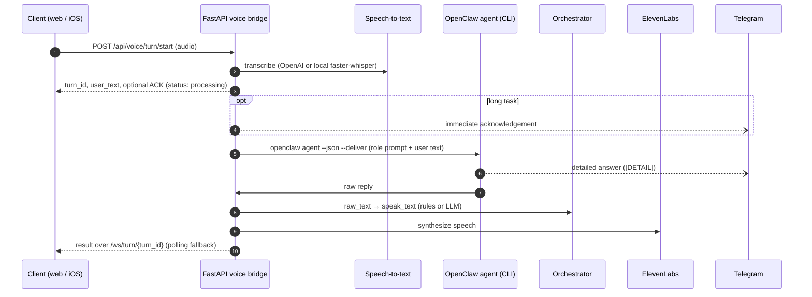

<p align="center">
  <picture>
    <source media="(prefers-color-scheme: dark)" srcset="docs/logo-dark.png">
    
  </picture>
</p>

<p align="center"><strong>A voice front-end for an AI agent that does real work.</strong><br>
Speak a request. The agent works on it, answers in natural speech and puts the details in Telegram.</p>

<p align="center">
  
  
  
  
  
  
</p>

<p align="center">
  <a href="https://github.com/kpr17ch/talka-ios">iOS client: talka-ios</a> ·
  <a href="https://github.com/kpr17ch/talkaz">Character frame generator: talkaz</a>
</p>

---

Talka is a voice bridge between a person and an autonomous coding/ops agent ([OpenClaw](https://github.com/openclaw/openclaw)). You tap a character and talk. The FastAPI backend transcribes the audio and starts an agent run. It then turns the agent's raw output into a short spoken answer, while code, logs, links and long reports go to Telegram. The two channels follow a written communication contract (`[VOICE]` / `[DETAIL]` / `[NEXT]`). Long tasks get an immediate spoken acknowledgement, and results arrive asynchronously over WebSocket. The prototype ran on a single VPS behind nginx with TLS and basic auth.

## How it works



The orchestrator prefers the agent's `[VOICE]` block. It removes Markdown, code, paths, URLs and shell commands from what is spoken and, when the reply was technical, adds a short pointer to the Telegram details. In `llm` mode it also returns structured panel data (current task, pinboard, work notes).

## Features

- **Async turn API**: start a turn, follow it via WebSocket push (`/ws/turn/{turn_id}`) or polling (`/api/voice/turn/status/{turn_id}`), cancel it (`/api/voice/turn/cancel/{turn_id}`). A synchronous legacy endpoint is kept.
- **Adaptive acknowledgements**: `auto | always | off`, length thresholds, optional server TTS for the ACK (browser speech synthesis otherwise) and a separate instant Telegram ACK before long agent runs.
- **Two-channel communication contract**: role prompt and response format in [`docs/assistant-communication-contract.md`](docs/assistant-communication-contract.md).
- **Speech-to-text**: OpenAI transcription API with retry/backoff, or local `faster-whisper`.
- **Text-to-speech**: ElevenLabs with tunable stability, similarity, speed and style.
- **Character UI**: canvas-rendered frame set with chroma keying. Mouth shapes are sequenced from the reply text (German-aware, e.g. `sch`) and pause on silence detected from the audio signal. A work-idle loop plays while the agent is busy.
- **Wake-phrase endpoint**: `/api/voice/wake/turn/start` with fuzzy matching (similarity threshold, prefix offset).
- **Hardening**: CORS allowlist, upload size and MIME checks, per-client rate limit, nginx rate limit, basic auth, systemd unit, Let's Encrypt TLS.
- **Observability**: per-stage timings in a `Server-Timing` header, `/api/health` with dependency status, optional full-text debug logging.
- **Tests**: pytest suite for the orchestrators, OpenClaw client, ACK logic and wake-phrase matching.

## Tech stack

| Layer | Technology |
| --- | --- |
| API | Python, FastAPI, Uvicorn, Pydantic Settings, httpx, WebSockets |
| Agent | OpenClaw CLI (`openclaw agent`), Telegram delivery |
| Speech | OpenAI transcription (`gpt-4o-transcribe` / `whisper-1`) or faster-whisper; ElevenLabs TTS |
| Orchestration | Rule-based cleanup or OpenAI chat model (`gpt-4o-mini`) with JSON output |
| Frontend | Vanilla JS, Canvas 2D, MediaRecorder, Web Audio |
| Ops | systemd, nginx, Certbot, Git-based pull deploy |

## Quick start

Requires Python 3.11+, the `openclaw` CLI on `PATH` (with a configured Telegram channel) and API keys for OpenAI and ElevenLabs.

```bash
python3 -m venv .venv
source .venv/bin/activate
pip install -r requirements.txt
cp .env.example .env          # fill in keys and OPENCLAW_TO
uvicorn app.main:app --reload --host 127.0.0.1 --port 8089
```

Open http://127.0.0.1:8089 and click the character to talk. `GET /api/health` shows which dependencies are ready.

Run the tests:

```bash
pytest
```

## Environment variables

See [`.env.example`](.env.example) for defaults.

| Group | Variables |
| --- | --- |
| Server | `VOICE_BRIDGE_HOST`, `VOICE_BRIDGE_PORT`, `MAX_AUDIO_MB`, `REQUEST_TIMEOUT_SECONDS`, `CORS_ALLOW_ORIGINS`, `RATE_LIMIT_PER_MINUTE`, `TURN_JOB_TTL_SECONDS`, `TURN_JOB_MAX_ENTRIES`, `TURN_POLL_AFTER_MS` |
| Acknowledgements | `TURN_ACK_MODE`, `TURN_ACK_TEXT`, `TURN_ACK_AUTO_MIN_CHARS`, `TURN_ACK_AUTO_MIN_WORDS`, `TURN_ACK_TTS_ENABLED`, `TURN_ACK_SEND_TO_TELEGRAM`, `TURN_ACK_TELEGRAM_TIMEOUT_SECONDS` |
| Wake phrase | `WAKE_PHRASE`, `WAKE_PHRASE_SIMILARITY_THRESHOLD`, `WAKE_PHRASE_MAX_OFFSET_TOKENS` |
| OpenClaw | `OPENCLAW_BIN`, `OPENCLAW_CHANNEL`, `OPENCLAW_TO`, `OPENCLAW_ROLE_PROMPT_ENABLED`, `OPENCLAW_TIMEOUT_SECONDS`, `OPENCLAW_PROCESS_GRACE_SECONDS` |
| Telegram mirror | `MIRROR_USER_TEXT_TO_TELEGRAM`, `USER_TEXT_MIRROR_CHANNEL`, `USER_TEXT_MIRROR_TARGET`, `USER_TEXT_MIRROR_LABEL`, `USER_TEXT_MIRROR_MAX_CHARS`, `USER_TEXT_MIRROR_TIMEOUT_SECONDS` |
| Speech-to-text | `STT_PROVIDER`, `OPENAI_API_KEY`, `OPENAI_STT_MODEL`, `OPENAI_BASE_URL`, `STT_OPENAI_MAX_RETRIES`, `STT_OPENAI_RETRY_BACKOFF_MS`, `STT_LANGUAGE`, `LOCAL_WHISPER_MODEL` |
| Orchestrator | `ORCHESTRATOR_MODE`, `ORCHESTRATOR_MODEL`, `ORCHESTRATOR_MAX_SPEAK_CHARS`, `ORCHESTRATOR_VOICE_DETAIL_HINT`, `ORCHESTRATOR_LLM_TIMEOUT_SECONDS`, `PANEL_STATE_TTL_SECONDS` |
| ElevenLabs | `ELEVENLABS_API_KEY`, `ELEVENLABS_VOICE_ID`, `ELEVENLABS_MODEL_ID`, `ELEVENLABS_STABILITY`, `ELEVENLABS_SIMILARITY_BOOST`, `ELEVENLABS_SPEED`, `ELEVENLABS_STYLE` |
| Logging | `DEBUG_LOG_FULL_TEXT` |

## Project structure

```text
app/
  main.py              # API routes, async turn jobs, WebSocket push
  stt.py / tts.py      # OpenAI or faster-whisper STT, ElevenLabs TTS
  openclaw_client.py   # agent CLI calls, Telegram mirror and ACK
  orchestrator.py      # rule-based voice cleanup
  llm_orchestrator.py  # LLM voice rewrite + dashboard panels
  turn_ack.py          # adaptive acknowledgements
frontend/              # character UI (index.html, app.js, styles.css, frame assets)
assets/characters/src/ # SVG sources + generator for the bundled character (Fenna)
deploy/                # systemd unit, nginx configs, deploy scripts
docs/                  # communication contract, deploy workflow
tests/                 # pytest suite
```

## Deployment

Production runs as `voice-bridge.service` behind nginx. TLS comes from Certbot and access is protected with basic auth. Deploys are Git-based: push to `main`, then pull and restart on the server with `deploy/scripts/deploy-hetzner`. Details are in [`docs/git-deploy-workflow.md`](docs/git-deploy-workflow.md).

## Status

Working single-user prototype (February–March 2026).

- Turn jobs, panel state and rate limits are kept in memory, so the server runs as a single process.
- The web UI is deliberately minimal (character only). Panel data from the LLM orchestrator is produced but not shown.
- The wake-phrase endpoint exists, but neither client uses it yet.
- Prompts and the default STT language are German.
- The UI animates a 10-frame character set (idle, smile, four mouth shapes, four work frames). The bundled character is Fenna, an original flat-vector avatar built from SVG shapes in [`assets/characters/src/`](assets/characters/src/) (`python3 assets/characters/src/generate.py --out frontend/assets/character --format jpeg` re-renders the green-screen frames `avatar_*.jpeg` with headless Chrome). [talkaz](https://github.com/kpr17ch/talkaz) can generate a frame pack in exactly this format from a photo.
